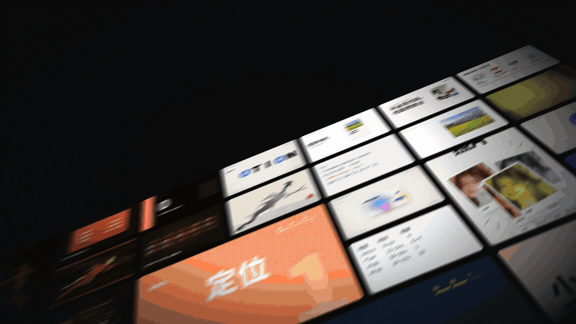
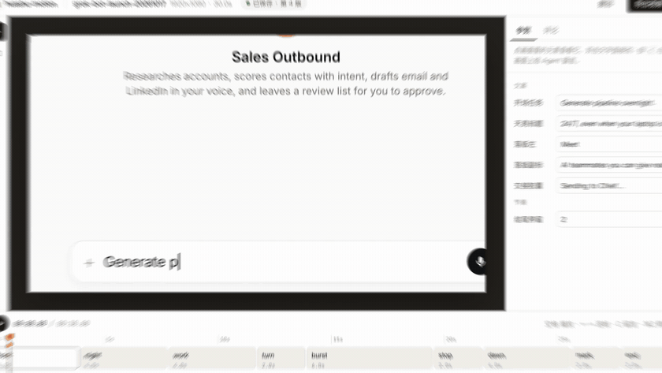
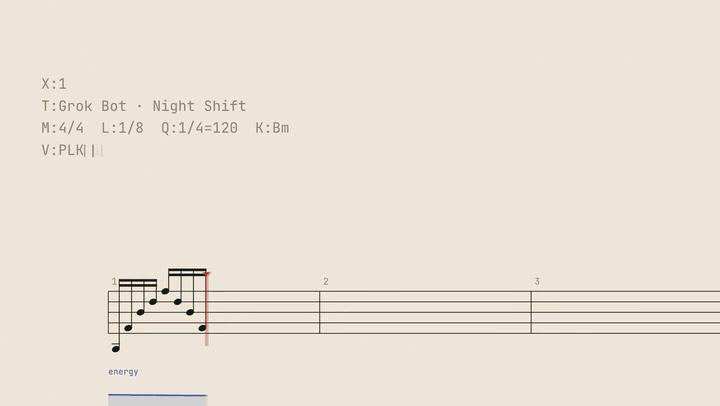
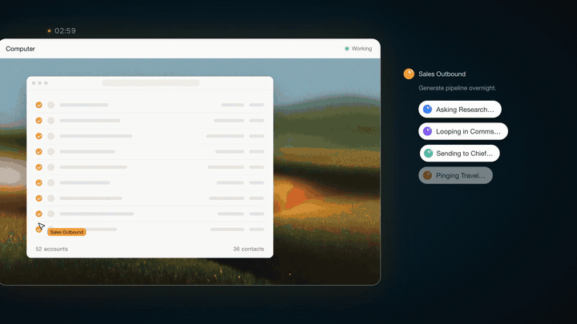
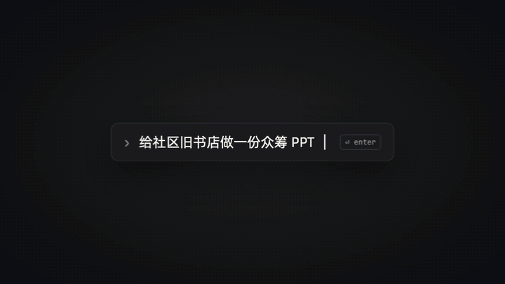
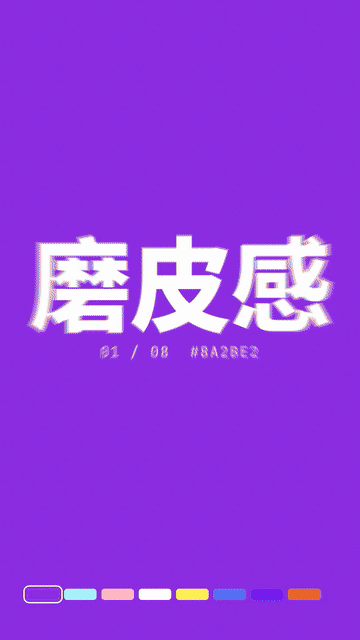
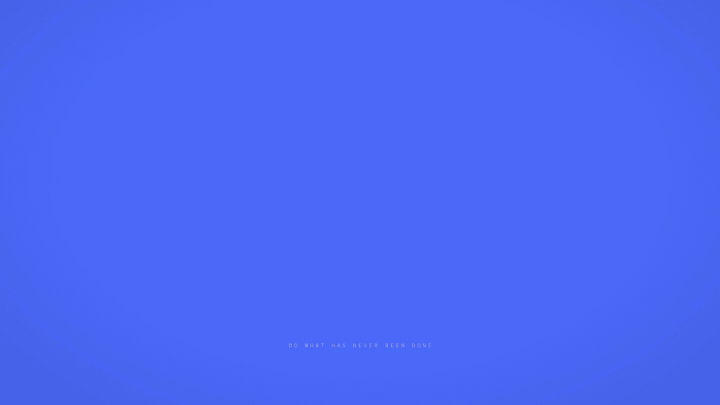

<div align="center">

[简体中文](README.md) | **English**



# huashu-motion

> *"Commercial-grade product launch films, in one go."*

[](LICENSE)
[](https://agentskills.io)
[](#install)

**Your coding agent makes the motion graphics, writes the score, and you point at the frame to change it.**

Tell Claude Code or Codex "make a 30-second launch film for my product". It reads the product, shows you three directions,<br>
writes the film, composes its music, and opens an editor in your browser.<br>
Click the frame where something is off, type what you want, and it changes exactly that.

```sh
npx skills add alchaincyf/huashu-motion
```

[See it](#see-it) · [Install](#install) · [What it does](#what-it-does) · [How it works](#how-it-works)

</div>

---

## See it

Every animation in this README was made with huashu-motion. The clip above opens the 53-second film it made about itself. 👉 [Download the full film (MP4, with sound)](https://github.com/alchaincyf/huashu-motion/releases/latest); the full Grok Bot, huashu-design and DeepSeek films are on the same page.

### Point at the frame



Press **C**, click the frame, type the change. The comment carries the time, the scene, the object under your cursor and its line in the source. The agent looks at that frame and a close-up of the spot first, changes only that, and replies in one line; the preview reloads where you were. Every version is kept and ⌘Z undoes. Titles, numbers, colours and hold times show up as fields you can edit yourself.

(The editor and terminal in this clip are rebuilt from the real interface; code details are illustrative. The comment is a real one.)

### Score first, then the picture



For launch films the agent writes a score in ABC notation, with marks that land on the scenes, and a sampled grand piano, string sections and drum kits play it (after a one-time `om samples build`; otherwise synths). Each landing gets a sound effect on its frame. All of it is generated locally; no paid API.

### Twenty films in a day


Sixteen shots from seven films made the same day, cut on the beat.



Grok Bot (fan-made, not official) · 30 s: hand over the work in the evening, agents work through the night, reports land on your phone at 7 am. This is the stretch where the reports go to the Chief of Staff.

<table><tr>
<td width="50%"><br/>huashu-design 3.0 · one prompt stays put, the styles behind it change on the beat</td>
<td width="50%" align="center"><br/>Catlight Pro · eight light colours, one per beat</td>
</tr></table>

### It doesn't need Opus: DeepSeek V4.1 Flash



This 22-second film was made with Claude Code running on DeepSeek V4.1 Flash (the 1017 release). I gave three rounds of notes (add DeepSeek's whale logo, drop a few shots); with music and effects it took under half an hour and cost ¥1.95 at the time (99.4% cache hits). The single palette, the dot carried through the film and the music locked to 124 BPM came from the skill; I never asked for them. With the method in the skill, a cheap model makes a good film too.

---

## Install

Ask your agent:

```
Install the huashu-motion skill (github.com/alchaincyf/huashu-motion) and run the demo
```

Or:

```sh
npx skills add alchaincyf/huashu-motion
```

Or clone the repo and link `skills/huashu-motion` into your agent's skills folder; the skill's `bin/om` then runs the CLI from the clone.

It runs in Claude Code, Codex, WorkBuddy, Grok Bot, Muse, Dots and more; it follows the [Agent Skills](https://agentskills.io) standard, so any skill-capable agent can install it.

Requirements:

- Node 22+.
- Google Chrome, Chromium or Edge. Stills, checks and export run in the browser you already have; no renderer is downloaded.
- FFmpeg, for export and the soundtrack.
- Optional: `om samples build` downloads a ~55 MB pack of CC0 / CC-BY instrument samples once; without it the music uses synths.
- Optional narration: macOS system voices need nothing; Kokoro voices print a one-line setup the first time (uv and Python 3.12, a ~325 MB model); word timing needs `whisper-cli` (`brew install whisper-cpp`).

`om doctor` tells you what is missing. Tested on macOS only so far. Codex's sandbox blocks the local preview and the browser; approve them when asked.

---

## What it does

| You say | It does |
|---|---|
| "Make a 30-second launch film for my product, site is xxx.com" | Reads the product, shows three directions as key frames, writes a rhythm sheet, builds the film, scores it, opens the editor |
| "Turn data/funnel.csv into a 30-second explainer on why signups doubled" | A data story: axes, then data, then one annotation; numbers become editable fields |
| "Add narration from my recording: voice.m4a" | Word-level alignment, motion lands on the word, subtitles, music ducks under the voice |
| "Package this talking-head video" | Name plate, number cards, keyword captions, chapter cards, exported as a transparent overlay for CapCut or Premiere |
| "Make it vertical" | A 1080×1920 copy, with the re-layout waiting in the inbox |
| "Export a GIF" / "transparent" / "a page to share" | MP4, MOV (alpha), WebM, GIF, or a share page with a player and the source |

Before a film it reads your past preferences and what earlier films taught; after it, it keeps what is worth keeping. Your preferences stay on your machine.

## How it works

- **A film is one `index.html`.** GSAP, Canvas, Three.js, SVG, anything a browser draws. No video model; every frame is a function of the code and the time.
- **Director rules, not templates.** Measured from 21 real launch films (cuts, beats, loudness, energy curves) and 142 high-engagement launch and motion films, organised into 20 motion languages. Every film starts with a rhythm sheet: a hook within 3 s, a burst in the middle, a beat of silence before the biggest hit.
- **Sound is half of it.** Composer mode (the agent writes the score, sampled instruments play it), 12 product types × 3 fallback music directions, 23 sound effects placed on the line where the motion lands, narration from a system voice or your own recording.
- **Its own render engine.** Several Chrome instances at once (by CPU count, up to 8 by default), picture and audio encoded in parallel, unchanged music reused. A 30-second film renders in about 12–15 s on my 14-core Mac; with motion blur, about 1–1.5 min.
- **Checked before delivery.** `om check` (scripts, files, motion rules, cut-off or covered text), `om qa` (single-frame pops, dead time, motion curve), and the skill asks the agent to watch the frames and, when it can, have another agent review cold.

| Command | What it does |
|---|---|
| `om new` · `om templates` | Start a project, from one of 10 templates |
| `om studio` | Live preview, scene strip, direct edits, frame comments |
| `om inbox --wait` · `om look` · `om done` | Agent side: take the next comment, see the spot, report back |
| `om sound` · `om voice` · `om samples` | Music and effects, narration, the instrument pack |
| `om check` · `om qa` · `om still` | Before and after rendering |
| `om render` · `om export html` · `om fork` | Export, share page, new frame size |
| `om learn` · `om undo` · `om doctor` | Experience, undo, environment check |

## What's inside

| | |
|---|---|
| Motion languages, each with what it says, what it suits and how to build it | 20, `skills/huashu-motion/references/library/` |
| Starter templates (keynote, finance chart, kinetic type, whiteboard, Vox collage, 3Blue1Brown, Kurzgesagt, talking-head package, …) | 10, `templates/` |
| Sound effects | 23 |
| Fallback music directions | 12 product types × 3 |
| Annotated example scores | 3, `skills/huashu-motion/references/scores/` |
| Fonts (CJK 500–900, serif, display) | 27, `fonts/` |

## Limits

- It can't hear. The agent checks music through the score, the energy curve and a spectrogram; the last listen is yours.
- It doesn't generate people or live footage. Everything is drawn in code; bring your own footage and it composes and packages it.
- Results depend on the model. I mostly use Opus 5.5 in Claude Code; DeepSeek V4.1 Flash does well too, but taste differs between models.
- It needs a machine that can run Node, Chrome and FFmpeg.

## Why it exists

On 8 October 2026 Anthropic released Claude Motion: Claude animates reports, charts and product explainers in code, and you point at a part to edit it. At launch it was a beta for Team and Enterprise only. In April I had turned Claude Design's core ideas into a skill, [huashu-design](https://github.com/alchaincyf/huashu-design); after Motion came out I gave Claude Code one line: *our skill should fully reproduce Claude Motion, and be much stronger.*

The first day's result was dull: an editor, version history, a hundred-odd tests, and a 19-second 3D city whose camera moved so evenly it was mediocre. Claude's own review said it had built a project very good at proving it wasn't lying, and nothing anyone would want to share. We started over that day. Most of the time since went into making the films good: measuring real launch films, asking for film-score music, and turning every "not cool", "boring" or "ugly font" into a rule in the skill. Then it made its own launch film, the one at the top of this page.

## Credits and license

Code and docs are MIT. Bundled third-party pieces keep their licenses: GSAP (GSAP Standard License) and the fonts (SIL OFL 1.1). Instrument samples, the Kokoro voice model and whisper.cpp models are downloaded from their sources on first use and not redistributed. The films that were measured are kept as numbers only, no frames. The `om demo` film uses the painting engine from [huashu-art-motion](https://github.com/alchaincyf/huashu-art-motion). See [THIRD_PARTY.md](THIRD_PARTY.md).

Exception: the "bean Huashu" character (drawn in `runtime/clip/lib/toon.js`, and as it appears in the storytime template and demo films) is Huashu's cartoon likeness, for demonstrating this project only, and is not licensed under MIT for other uses.

## About the author

**Huashu (花叔)** — AI-native coder and indie developer. Known for Catlight (小猫补光灯, #1 on the App Store paid chart).

| | |
|:---|:---|
| 🌐 Site | [bookai.top](https://bookai.top) · [huasheng.ai](https://www.huasheng.ai) |
| 𝕏 Twitter | [@AlchainHust](https://x.com/AlchainHust) |
| ▶️ YouTube | [@Alchain](https://www.youtube.com/@Alchain) |
| 📺 Bilibili | [花叔v](https://space.bilibili.com/14097567) |


---

<div align="center">

**[nuwa-skill](https://github.com/alchaincyf/nuwa-skill)** makes skills. **[huashu-design](https://github.com/alchaincyf/huashu-design)** designs. **[huashu-art-motion](https://github.com/alchaincyf/huashu-art-motion)** makes paintings move. **huashu-motion** lets your agent make the launch film.

MIT License © [花叔 Huashu](https://github.com/alchaincyf)

</div>

---

<div align="center">
<sub>also by 花叔</sub>

[](https://github.com/alchaincyf/fanbox)

</div>
